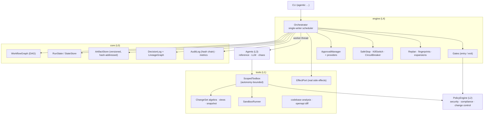
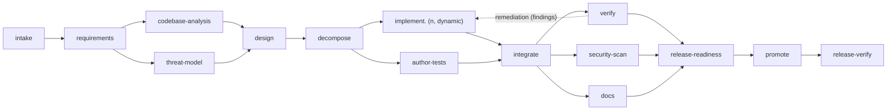
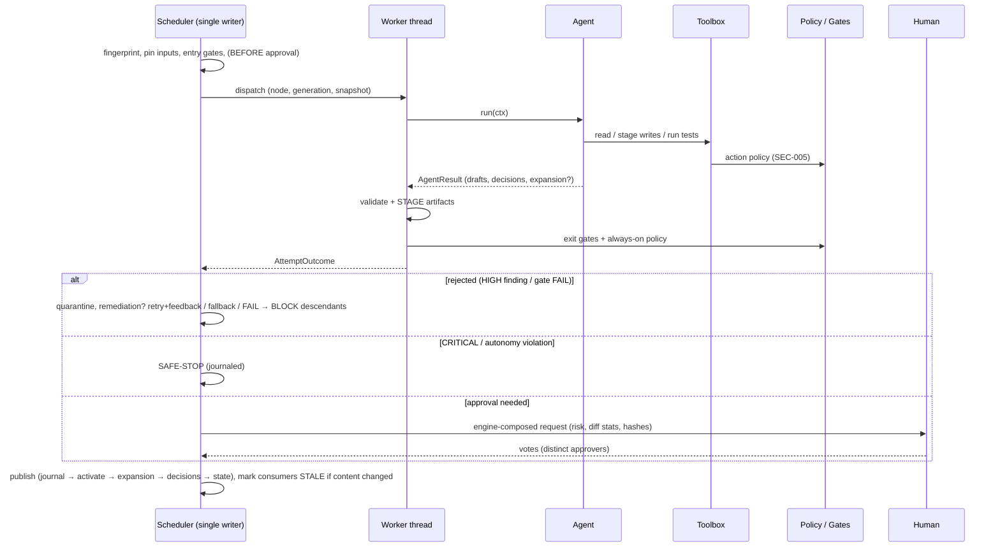

# Architecture overview

This repository contains two cooperating systems:

| System | Package | What it is |
|---|---|---|
| **URL shortener service** | `shortener/` | The product: a FastAPI service with link creation, redirects, analytics and reliability features. The hand-built **reference product** that the brownfield and ambiguous scenarios evolve. |
| **Agentic SDLC orchestrator** | `orchestrator/` | The differentiator: a governed, stateful, non-linear workflow engine that turns a *requirement* into a *reviewable engineering outcome* (requirements → analysis → design → implementation → tests → docs → release readiness) by coordinating agents under policy guardrails and human approval. |

The orchestrator is generic; three shipped scenarios (greenfield, brownfield, ambiguous) point it at the shortener.

> **Principle.** Agents execute under defined autonomy boundaries; humans own oversight, approvals and final quality.
> Agent output is *untrusted input*: it becomes a proposal (an immutable artifact / change set) that must pass gates,
> policy checks and — for high-impact actions — human approval before it influences anything real.

Companion documents: [`engine-semantics.md`](engine-semantics.md) (exact behaviour), [`sdlc-contract.md`](sdlc-contract.md) (the standard workflow node by node),
[`artifact-schemas.md`](artifact-schemas.md), [`module-reference.md`](module-reference.md), [`scenarios.md`](scenarios.md), [`testing.md`](testing.md), [`risks-and-tradeoffs.md`](risks-and-tradeoffs.md).

---------------------------------------------------------------------------

## 1. Components



### 1.1 Workflow graph (explicit dependency graph)
A workflow is a DAG of `NodeSpec`s. Each node declares `depends_on` (join = barrier: it starts only when **all** dependencies are satisfied),
typed artifact contracts (`consumes`/`optional_consumes`/`overlay_from`/`produces`, proven at build time against *ancestor* producers),
entry/exit gates, `agent` + `fallback_agent`, bounded `retry`, `approval`, `risk`, `mandatory`, `skip_if`, `remediation`, and
`side_effecting` + `compensator`. The graph is JSON-serialisable and supports **dynamic expansion**: the planning node declares the
implementation sub-nodes at run time, so the executed graph is *generated from the decomposition*.


Parallelism is structural: `codebase-analysis ‖ threat-model`, `implement.* ‖ author-tests`, `verify ‖ security-scan ‖ docs`, re-joined at barriers.
**Non-linearity** comes from four mechanisms: parallel fan-out/fan-in, the **remediation feedback edge** (a failing `verify` routes its findings back to
the implementation nodes and re-runs), **invalidation loops** (an upstream change makes completed nodes stale and re-validates them), and **dynamic expansion**.

### 1.2 Node lifecycle
`PENDING → READY → RUNNING → (exit gates) → AWAITING_APPROVAL | AWAITING_INPUT → SUCCEEDED`, with `FAILED → ROLLED_BACK`, `SKIPPED`, `STALE`, `BLOCKED`,
`CANCELLED`, `REMOVED`. The transition table (`types.ALLOWED_TRANSITIONS`) is enforced by a single `transition()` function. Run status:
`CREATED → RUNNING ⇄ WAITING_HUMAN → SUCCEEDED | FAILED | SAFE_STOPPING → SAFE_STOPPED`. See `engine-semantics.md` §3.

### 1.3 Scheduler: single-writer, stateful, resumable
One scheduler thread is the only writer of run state; attempts run on worker threads that **stage** their output and run gates/policy, returning one
`AttemptOutcome`; the scheduler only *applies transitions*. State is persisted atomically after every transition next to a hash-chained audit log; a
paused run (`WAITING_HUMAN`) can exit and `resume`. Commands (`approve`, `answer`, `amend`, `kill`) are queued through an inbox when an engine is live.
**Fingerprint memoisation** (node spec + agent version + pinned input hashes + baseline + policy) gives minimal re-execution; **verdicts are never cached** —
gates, policy and approval validity are re-evaluated on every cache hit. Time is injected; the scheduler never `sleep`s except on a pure back-off wait.

### 1.4 Gates
Entry gates run before an attempt (inputs present/valid, approvals still valid; an entry failure fails fast — it is not retried). Exit gates run on the
**staged** output: contract and shape, the **always-on policy evaluation**, then node-specific gates (traceability, tests passed, fail-to-pass, API
compatibility, …). All gates are evaluated; precedence `SAFE_STOP > FAIL > AWAIT_INPUT > REQUIRE_APPROVAL > PASS`. Only when everything passes are staged
artifacts **published**; otherwise they are **quarantined** (attempt-level rollback with zero side effects).

### 1.5 Policy guardrails (security, compliance, change control)
Executable rules evaluated by a `PolicyEngine` on *subjects* (change set, artifact, tool action, plan expansion, run). Severity → enforcement:
INFO/LOW → warn; **MEDIUM → human waiver required** (bound to the finding and the evidence hash); **HIGH → rejected** (retry with feedback → fallback → fail; not
waivable); **CRITICAL → safe-stop**. Severity overrides are *raise-only* (floors for SEC-*, CHG-001/006/007/008, QLT-001); a crashing rule fails closed.

| ID | Category | Rule | Severity |
|---|---|---|---|
| SEC-001 | security | Hard-coded secret / private key / credential in any artifact, change set, path or description | HIGH (private key: CRITICAL) |
| SEC-002 | security | Dangerous Python construct (`eval`, `exec`, `os.system`, `shell=True`, `pickle.loads`, unsafe `yaml.load`, `verify=False`, dynamic `getattr` on dangerous modules, `__import__`) | HIGH |
| SEC-003 | security | HTTP route added/changed without an auth dependency (public allow-list: `GET /{code}`, `/healthz`, `/readyz`) | HIGH |
| SEC-004 | security | SQL assembled by string formatting/concatenation | HIGH |
| SEC-005 | security | Autonomy-boundary violation: op path outside `write_globs`, too many changed files, traversal / absolute / reserved path, unauthorised execute | CRITICAL (path escape) / HIGH (out of scope) |
| SEC-006 | security | Prompt-injection indicators in human-supplied text (request, answers, amendments, comments) | MEDIUM (human confirmation) |
| SEC-007 | security | Trojan-source / bidi / zero-width / non-ASCII identifiers in code or docs | HIGH |
| SEC-008 | security | Egress/execution libraries (`subprocess`, `socket`, `urllib.request`, `ctypes`, …) outside allow-listed modules | HIGH |
| CMP-001 | compliance | Traceability: every active acceptance criterion has a *passed* covering test (or inspection evidence, or a human-approved deferral) | HIGH (release) |
| CMP-002 | compliance | Personal-data hygiene: raw IP / user-agent persisted or logged unhashed | MEDIUM |
| CMP-003 | compliance | Decision-record completeness: high-impact nodes have valid, non-stale, sufficient approvals; every waiver has a decision | HIGH (release) |
| CHG-001 | change control | Applied DB migrations are immutable (modify/delete of an existing migration) | HIGH |
| CHG-002 | change control | Change-size budget exceeded (files / lines) | MEDIUM |
| CHG-003 | change control | Scope: modified existing files must lie inside the impact set ∪ recipe anchors (fails closed without an impact report) | MEDIUM |
| CHG-004 | change control | Breaking public API change (OpenAPI diff vs the declared contract) | HIGH |
| CHG-005 | change control | Release requires a change reference and a rollback plan | HIGH (release) |
| CHG-006 | change control | A re-plan may not remove/alter a `mandatory` governance node | HIGH |
| CHG-007 | change control | Plan expansion must conform to the owner's template/policy (agents, stages, produces, rewire targets) | HIGH |
| CHG-008 | change control | Protected paths (CI, Dockerfile, dependency manifests, env files, `.git`) are not modifiable by agents | HIGH |
| QLT-001 | quality | Changed Python files must be syntactically valid | HIGH |

SEC-002/003/004/006 are **heuristic tripwires, not a security boundary**; the boundary is structural: proposals only, autonomy checks, sandboxed execution, human approval.

### 1.6 Controlled autonomy
Each agent has an `AutonomyProfile` (read/write globs, may-execute, call/size/time budgets); a node may only *narrow* it. Agents act **only** through a per-attempt
`Toolbox`: reads see an overlay (baseline + declared upstream change sets), writes are **staged** into a `ChangeSet` proposal, every call is policy-checked and
audited, a valid path outside `write_globs` is denied (escalating on repetition), and traversal/absolute/reserved paths are CRITICAL. The same bounds are
re-checked by SEC-005 on every produced change set, so an agent cannot bypass the toolbox by returning raw JSON. Agents see only declared artifacts, pinned at dispatch.
Test execution happens in a scratch copy with an allow-listed environment, a fixed `pytest` argv, bounded output and tree-kill on timeout — *process-level isolation, not
a security sandbox* (see limitations).

### 1.7 Human approvals
`ApprovalSpec` on a node (`BEFORE` approves the start, `AFTER` the output). Approval is required when `always` or when the **assessed risk** (node risk ∨ gate-computed risk
such as `design_risk` ∨ change-set risk — migrations, auth/security modules, deletions, size, API surface ∨ MEDIUM findings) reaches the threshold (scaled by the run's autonomy
mode: supervised / guided / autonomous). Below the threshold the engine records an *automatic policy approval* (audited, never silent). Required approvers scale with risk
(**HIGH = 2 distinct humans**). Requests carry an **engine-composed summary** of structured facts only (agent prose is shown in a labelled, sanitised block). Approvals are bound
to the node's input fingerprint (lazily compared — a cache hit keeps a still-valid approval) and to an evidence hash re-verified at publish. Identity is *asserted, not
authenticated* (stated limitation); controls: normalised names, reserved-name denial, separation of duties, optional allow-list, recorded OS user, `--confirm` of the evidence
prefix, and a `DEMO_SCRIPTED` banner when approvals are scripted.

### 1.8 Reliability controls
* **Bounded retries** with exponential back-off and feedback injection; **fallback** agent with its own budget; **remediation** loops (bounded) for quality failures.
* **Rollback** at three levels — attempt (quarantine), node (descendants blocked; `compensates` ⇒ saga compensation of side-effecting ancestors), run (reverse-order
  compensation on safe-stop) — from persisted `ApplyReceipt`s with a fresh cancel token.
* **Safe-stop** — a *journaled*, crash-resumable procedure (S0–S6): record decision first, cancel + quiesce, quarantine, compensate, cancel the rest. Triggers: CRITICAL finding /
  autonomy violation, budgets, circuit breaker, kill switch (fail-closed file check, honoured across processes), audit-integrity failure, failed compensation. Leaving it requires an
  attributed, bounded override (two approvers for integrity/autonomy/compensation triggers).
* Global bounds make runaway behaviour impossible: attempts, replans, remediation loops, clarification rounds, node count, zombies, runtime.

### 1.9 Dynamic re-planning
Triggers: a human `amend`/`answer`, a node re-publishing different content, a new `PlanExpansion`, remediation routing, override-resume. The changed artifact's consumers and descendants
become `STALE` (running descendants are cancelled and their late results discarded by generation number), then revalidate via fingerprints: **unchanged ⇒ cache hit** (outputs restored,
verdicts re-run, approvals kept), **changed ⇒ re-run through all gates**. Expansions are **untrusted**: governance attributes are overwritten from the owner's template, agents/stages/produces are
allow-listed, mandatory nodes are pinned, the diff is applied atomically at publish and recorded as a `REPLAN` decision (`added/removed/retained/invalidated/cache_hit`).

### 1.10 Context, lineage, audit
* **Artifacts** — versioned per `(kind, key)`, content-hash addressed; each carries the exact input refs from the dispatch-time snapshot ⇒ a derivation DAG.
* **Decisions** — append-only records of *why* (design choices with alternatives, assumptions, clarifications, approvals, waivers, retries, fallbacks, remediation, rollbacks, re-plans,
  safe-stop) with `inputs`/`outputs`/`parents` ⇒ a decision DAG. `agentic lineage <artifact>` walks both and must reach, e.g., the clarification that shaped a release patch.
* **Audit log** — every transition, gate result, policy evaluation (positive evidence included), tool call and vote; SHA-256 chain; audit head saved in state and appended to an external anchor
  file; `seal.json` at terminal state; torn-tail recovery; reconcile-on-resume. *Tamper-evident against accidents and casual edits, not against a privileged same-user attacker.*
* **Metrics** — event-sourced: success rate, **retry frequency**, fallback rate, **rollback frequency**, **MTTR** (excluding human wait), **end-to-end latency** split into active and human-wait,
  per-stage latency, critical path, observed concurrency, re-plan reuse ratio.

### 1.11 Attempt lifecycle



---------------------------------------------------------------------------

## 2. The standard SDLC workflow

Exact node table (consumes/produces/gates/approvals): [`sdlc-contract.md`](sdlc-contract.md). Summary: `intake → requirements → (codebase-analysis ‖ threat-model) → design →
decompose → (implement.* ‖ author-tests) → integrate → (verify ‖ security-scan ‖ docs) → release-readiness → promote → release-verify`. `codebase-analysis` is *skipped for
greenfield*. `release-readiness` always needs a human go/no-go. `promote` writes the reviewed patch bundle; a real apply (`--apply-to`) is opt-in, side-effecting, approval-gated
and compensated by `release-verify` on failure. The **engineering summary** is an engine finalizer that runs for *every* terminal state (including failures and safe-stops).

---------------------------------------------------------------------------

## 3. Agents

Agents implement `Agent.run(ctx) -> AgentResult` and are interchangeable behind the registry (fresh stateless instance per attempt).

* **Reference agents (default, offline, deterministic).** Real analysis logic with no network or model dependency, so runs are reproducible in CI: heuristic requirements
  normalisation with a documented ambiguity taxonomy, AST-based codebase analysis with data-flow tracing, STRIDE-lite threat modelling, capability-driven decomposition,
  recipe-driven implementation (vetted, *typed-parameter* change recipes applied through the `Toolbox`), tests generated from acceptance criteria, real test execution,
  document generation from artifacts. They are **stand-ins for model-backed agents**: they cannot implement arbitrary requirements — unmatched requirements are surfaced to a
  human (`unsupported`) instead of guessed.
* **LLM agent (optional).** `LLMAgent` + `AnthropicProvider` (official `anthropic` SDK, optional extra, key from the environment) can serve a role as *primary* with the deterministic agent as
  *fallback*. Model output is hostile: strict allow-listed JSON parsing, engine-owned identity fields, secret scan of outbound prompts, egress opt-in, budgets — then the same gates, policies and
  approvals as any agent. Exercised in tests through recorded/hostile `ScriptedProvider` responses; **not exercised against the live API in this repository**.
* **Fault-injection agent.** `ChaosAgent` injects realistic failures (transient errors, hard-coded secret, edit of an applied migration, regression, path escape, route without auth,
  post-apply regression, double failure) so retries, fallback, remediation, rollback and safe-stop are **demonstrable and testable**.

---------------------------------------------------------------------------

## 4. Product architecture (`shortener/`)

```
HTTP (FastAPI) ─► api/ (routes, schemas, deps, error handlers, middleware)
                    └► services/ (LinkService, AnalyticsService, ClickRecorder, RateLimiter, LruTtlCache, Idempotency)
                         └► domain/ (validation, code generation, models, errors)   storage/ (SQLite repositories, versioned SQL migrations)
```
Stateless app + repository interfaces (swap SQLite for Postgres); LRU+TTL redirect cache; **non-blocking click ingestion** (bounded queue + background writer; failures never break a
redirect); token-bucket rate limiting with bounded state; `secrets` base62 codes with unique-constraint retry; SSRF-aware, canonicalising URL validation; API-key auth with owner scoping
(secure default: refuses to start without keys); privacy-preserving analytics (daily-salted HMAC visitor id, truncated IP, referrer host only, retention); request-id correlation, JSON
logs, `/healthz`, `/readyz`, `/metrics`. Full requirements: [`product-spec.md`](product-spec.md).

---------------------------------------------------------------------------

## 5. Control flow of one run (brownfield example)

1. `agentic run brownfield` → run dir, baseline snapshot, external artifact `request`, audit chain begins (`RUN_CREATED` with graph/policy/baseline hashes).
2. `intake` (classification, input screening) → `requirements` (normalised, assumptions as decisions, acceptance criteria) → `codebase-analysis ‖ threat-model`.
3. `design` — ADRs with alternatives; the `design_risk` gate sees a migration ⇒ **HIGH ⇒ two approvers** ⇒ the run pauses `WAITING_HUMAN` and exits (exit code 10).
4. Humans `approve` (distinct identities, `--confirm` evidence prefix) → `resume` → `decompose` publishes the plan and expansion → `implement.*` ‖ `author-tests`.
5. The primary implementer's output violates CHG-001 → rejected → retried with findings → **fallback** agent succeeds → `FALLBACK` decision.
6. `integrate` → `verify ‖ security-scan ‖ docs` (a failing test would route back via remediation) → `release-readiness` (CMP-001/003, CHG-005 evaluated against the live run) → **human go/no-go**.
7. `promote` writes the patch bundle; `release-verify` applies it to a fresh baseline copy and re-runs the suite; finalizers write `report.md`, `metrics.json`, `trace.json`, `seal.json`
   and the engineering summary.

---------------------------------------------------------------------------

## 6. Key decisions and trade-offs

| Decision | Alternatives | Why / trade-off |
|---|---|---|
| Agents emit **change-set proposals**, not file mutations | shared mutable workspace | Rollback = discard artifact; parallel agents cannot corrupt each other; reviewable, hashable patches. Cost: agents work through an overlay view. |
| **Single-writer scheduler** + worker threads that stage and gate | actors / per-node locks / asyncio | Deterministic state machine, one place to audit; gates never run on the scheduler thread. Cost: threads cannot be killed → cooperative cancel, generation-discard, zombie cap. |
| **Event-sourced metrics** from the audit log | separate metrics store | One source of truth, recomputable, tamper-evident. |
| **Fingerprint memoisation, verdicts never cached** | re-run everything / cache verdicts | Minimal re-execution without bypassing policy or approvals. Cost: fingerprints must capture every input; artifacts must be deterministic. |
| **Remediation edge** (verify → implement) | retry the same node | A failing test cannot be fixed by re-running the tester; routes findings to the cause. Cost: extra loop bound. |
| **Untrusted plan expansions** governed by an owner template | let the planner author nodes | Dynamic planning without letting an agent grant itself approvals, retries or privileged agents. |
| **Lazy approval invalidation** keyed on fingerprint | invalidate on STALE | A cache hit keeps a still-valid human approval; an actual change forces re-approval. |
| **Engineering summary as a finalizer** | an end node | Runs for failed and safe-stopped runs, where it matters most; limitations are computed from run facts. |
| **Deterministic reference agents** by default | LLM-only | Reproducible, offline, testable, safe by construction. Cost: limited generality — honest `unsupported` handling; LLM path available. |
| **JSON files + lock/inbox** for run state | SQLite / Postgres | Inspectable and dependency-free. Cost: one engine process per run (enforced by `run.lock`). |
| SQLite for the product | Postgres | Zero-ops prototype; repositories isolate the swap. Cost: single-node writes; cache/rate limiter are per-instance. |
| 302 (not 301) | 301 | Every click reaches analytics and links stay revocable. Cost: more redirect traffic. |
| API-key auth, refuse to start without keys | open by default | Secure default over convenience; explicit loopback-only `SHORTENER_AUTH_DISABLED=true` for local dev. |

---------------------------------------------------------------------------

## 7. Where to look next
[`engine-semantics.md`](engine-semantics.md) · [`sdlc-contract.md`](sdlc-contract.md) · [`module-reference.md`](module-reference.md) · [`scenarios.md`](scenarios.md) · [`testing.md`](testing.md) · [`risks-and-tradeoffs.md`](risks-and-tradeoffs.md) · [`product-spec.md`](product-spec.md)
